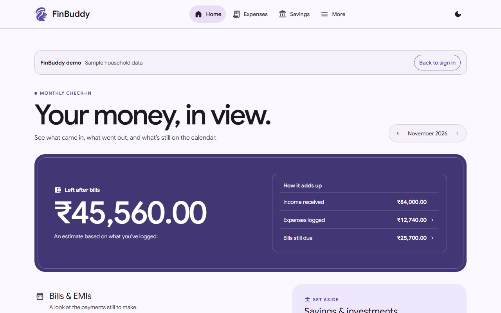
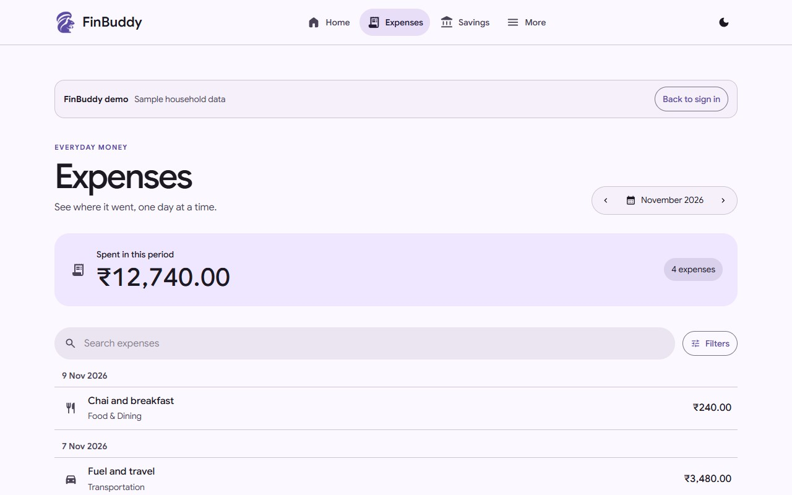
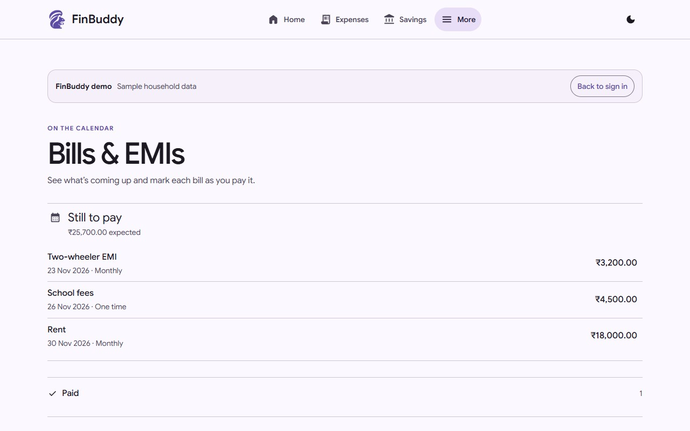
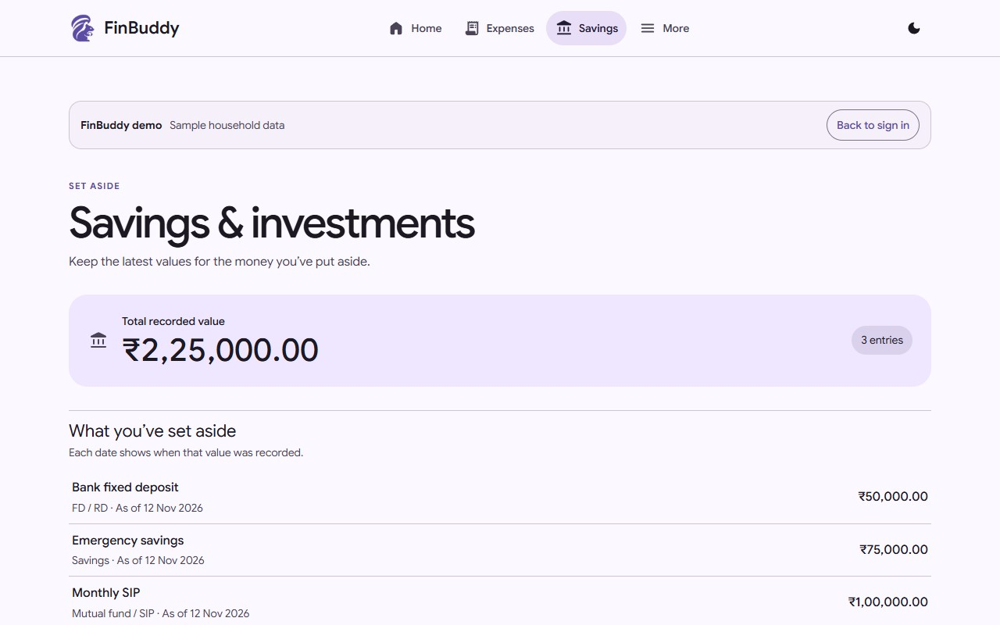

# FinBuddy

FinBuddy is an INR-first household finance workspace. See what came in this month, review what went out, check bills and EMIs, and keep dated records of savings and investments.

[Open FinBuddy](https://finbuddy-2025.web.app/) · [Try the sample household](https://finbuddy-2025.web.app/?demo=1) · [Watch the product tour](https://theharithsa.github.io/finbuddy/#tour) · [Help center](https://finbuddy-2025.web.app/docs/)

## A month in FinBuddy

The public demo opens without an account and uses a fictional household. Screenshots below show the running demo.

| Monthly Home | Expense ledger |
| --- | --- |
|  |  |
| **Bills & EMIs** | **Savings** |
|  |  |

The signed-in workspace adds expense entry and receipts, category budgets, recurring expense templates, and Developer Options for the REST API. The Savings view shows recorded values with an as-of date. [User guide](https://finbuddy-2025.web.app/docs/) · [API and Developer Options](docs/api.md)

## How it works

| Layer | Implementation |
| --- | --- |
| Web app | React, TypeScript, and Vite with Material 3 styles. Feature routes live in `src/features/`. |
| Account and data | Firebase Authentication, Firestore for financial records, and Cloud Storage for receipt attachments. |
| REST API | Firebase Functions serve `/api/v1` through Firebase Hosting. Developer Options issues scoped personal tokens. OpenAPI and Swagger describe the supported operations. |
| Money and dates | The household model stores integer paise. The monthly views use local calendar boundaries, and bill payments link to expense records. |
| Delivery | GitHub Actions runs foundation, web, browser, and API checks. Firebase Hosting serves the app. GitHub Pages publishes the product site from `site/`. |

[Service inventory](docs/services.md) · [Material 3 design](docs/design.md) · [Observability](docs/observability.md) · [Release and rollback](docs/release-plan.md)

## Run locally

Use Node.js 24. Start with the demo to explore the UI. Use the Firebase emulators before testing account creation, transaction writes, or token management.

```sh
npm ci
npm run dev
```

Open the address printed by Vite and add `?demo=1`. Use the testing guide for emulator commands and the API's Node.js 22 runtime. [Testing guide](docs/testing.md)

## Contribute and report issues

Start with a linked GitHub issue, keep changes focused, and include verification in your PR. Use synthetic data in public artifacts. Report suspected security issues privately through the repository's Security tab. [Contribution guide](CONTRIBUTING.md) · [Security policy](SECURITY.md) · [Issue forms](https://github.com/theharithsa/finbuddy/issues/new/choose) · [Project board](https://github.com/users/theharithsa/projects/1)

Licensed under [MIT](LICENSE). Template version: **1.13.0** · [App Launchpad provenance](project.json)
